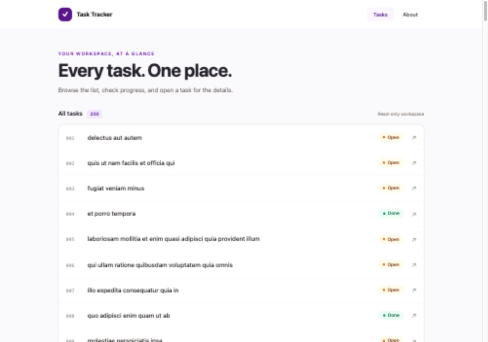

# Task Tracker

A read-only React task browser for Mini Project 1, Full Stack Development with AI. Browse tasks, open details, and inspect their Open/Done status.

## Run locally

Prerequisite: Node.js 22.12 or newer (validated with Node 24) and npm.

```sh
git clone https://github.com/rankinenovabos/mini-project-1-task-tracker.git
cd mini-project-1-task-tracker
npm ci
npm run dev
```

Open the local URL printed by Vite. Internet access is needed to retrieve API data.

```sh
npm run lint
npm test
npm run build
npm run preview
```

## Routes and components

- `/`: task list with actual response count, linked titles, task numbers, and status.
- `/tasks/:id`: dynamic detail view using `useParams`; includes user ID and back navigation.
- `/about`: purpose, technology, and data attribution.
- Unknown routes and missing tasks have friendly fallback screens.

`Layout` owns shared navigation. `TaskList` passes each task to `TaskRow`; `StatusBadge` renders completion state. Pages own queries and compose reusable loading, error, and empty-state components. React Router handles navigation; there is no duplicated task state in `useState`.

## Data and caching

Data comes from [JSONPlaceholder](https://jsonplaceholder.typicode.com/), using `/todos` and `/todos/:id`. Data is fetched through TanStack Query using `['todos']` and `['todo', numericId]`. The Query client is created once and uses a 60-second freshness window. Fresh data can be reused on navigation without a new request. This is in-memory application caching, not local storage or a periodic refresh timer.

Automatic retries are disabled so failures are visible; **Try again** manually refetches. Background refresh errors retain already loaded data. Invalid task IDs are rejected without a request. The app never writes to the API.

## Verify request states

`npm test` runs integration tests with mocked fetch responses. These are test-only fixtures; the normal app always uses the public API.

- **Success:** open the app with internet access.
- **Loading:** open browser Network tools, throttle the connection, and reload to clear in-memory Query data.
- **Error/retry:** block `https://jsonplaceholder.typicode.com/*` in browser Network tools and reload; unblock it and select **Try again**. Request blocking is preferable to offline mode, which may pause Query requests.
- **Empty:** `npm test -- -t 'shows an empty state'` supplies a controlled `[]` response and verifies the empty message.
- **Missing task:** open `/tasks/9999`; invalid IDs such as `/tasks/nope` are rejected locally.
- **Caching:** clear the Network log, visit a task, return to the list, and revisit that same task within 60 seconds. The integration suite also asserts the request count when revisiting two different tasks.
- **Accessibility:** tab through navigation and task links, check visible focus, and use the skip link. Resize to a narrow mobile viewport and verify there is no horizontal scrolling.

## Scope

React + Vite, React Router, TanStack Query, Tailwind CSS, ESLint, Vitest, and React Testing Library. No search, filters, task editing, statistics, login, backend, persistence, or deployment. User IDs are displayed as supplied by the API. Public API availability is outside the app's control.

See [PROJECT-BRIEF.md](PROJECT-BRIEF.md) for the rubric and source evidence. Its transcript reference points to local course materials outside this repository; those materials are intentionally not published.

## Screenshots



[Mobile task list](docs/screenshots/tasks-mobile.png) · [Task details](docs/screenshots/task-details.png) · [About](docs/screenshots/about-desktop.png)

[Loading](docs/screenshots/loading-state.png) · [Empty](docs/screenshots/empty-state.png) · [Error](docs/screenshots/error-state.png)

Request-state screenshots use controlled test-only responses. See [verification results](docs/VERIFICATION.md).

## Submission

Submit the GitHub repository link through Canvas. Confirm the exact deadline and ensure graders can access the repository. Deployment is not required. This repository does not automatically submit the assignment.
